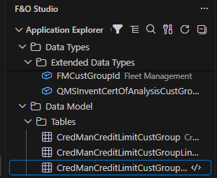
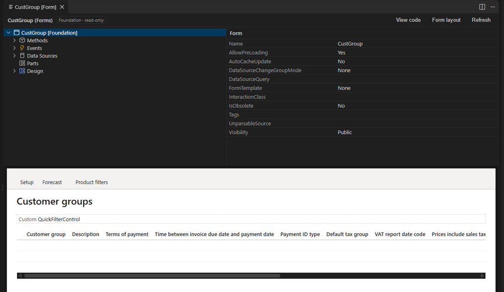
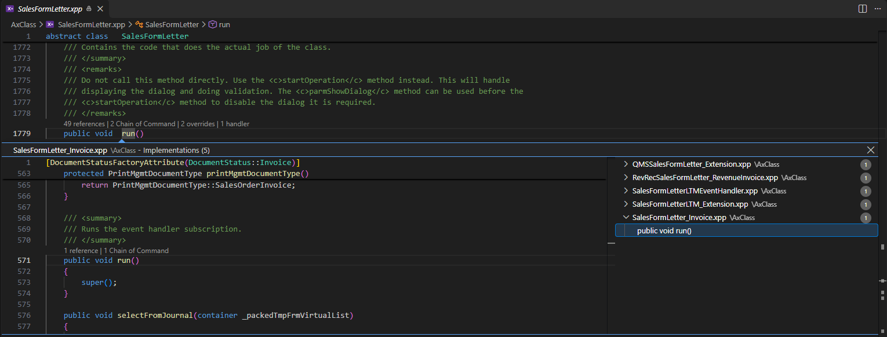

# F&O Studio for VS Code

A full Dynamics 365 Finance & Operations development environment in VS Code, with AI built in. It covers what the Visual Studio Dynamics 365 tools do: Application Explorer, designers, code editing, build, deploy, debugging, plus agent tools for Copilot.

It works against a unified developer environment (UDE), or on a cloud-hosted (CHE) or VHD environment, and uses the same metadata API, compiler and scripts as Visual Studio, so projects and models move freely between the two.

## Features

- **Application Explorer** with Visual Studio's classic and model views, projects (`.rnrproj`, compatible with Visual Studio), and right-click actions: references, extensions, Chain of Command, compare, hierarchy, ERD.
- **Designers** for every element type with Visual Studio's node order and Properties grid, a form preview rendered like the web client, event handler generation, a label editor and undo/redo.
- **Code editing:** code view of classes, Go to Definition, Find References, implementations of Chain of Command and event handlers, code lens, completion, hover, rename, quick fixes and snippets.
- **Build, test, deploy and debug:** X++ compiler with errors in Problems, best-practice checks, SysTest classes in Test Explorer, deployment packages, database sync and the debugger.
- **Data:** browse table rows, run SQL with an explain plan, and live performance insights; temporary database credentials on unified developer environments, the local AxDB on cloud-hosted and VHD.
- **Analysis:** performance anti-patterns, performance traces (`.etl`) with call trees and SQL per method, upgrade readiness (obsolete APIs), security licenses, access, gaps and segregation of duties, a pre-deploy checklist and Review My Changes for pull requests.
- **AI:** 30+ agent tools for Copilot (read, create and extend metadata through the metadata API, search standard code, analyze security and performance, build, test, query data), the `@fno` chat participant, team rules and a Copilot Activity view.

The full list is in the [feature reference](https://github.com/nazmolla/xpp-vscode/blob/main/docs/FEATURES.md).

## Requirements

- Windows.
- A Dynamics 365 Finance & Operations unified developer environment (**F&O Studio: Connect to Environment** installs the metadata, compiler and FinOps tools), or a cloud-hosted or VHD environment. On a cloud-hosted or VHD environment, run VS Code as administrator, as Visual Studio does, to build into PackagesLocalDirectory.
- SQL Server LocalDB, for cross references.
- [Power Platform CLI](https://learn.microsoft.com/power-platform/developer/cli/introduction) (`pac`), for deploy and database sync.

## Getting started

1. Open the **X++** view in the activity bar.
2. If the machine isn't set up yet, run **Connect to Environment** from the Dynamics 365 view.
3. Browse **Application Explorer**, or pick a project with **Open D365FO Project…** (or **Create D365FO Project…**); a project is optional.
4. Open elements, build, debug, or ask Copilot in agent mode to work on your model.

## Settings

| Setting | Description |
| --- | --- |
| `xpp.project` | The project (`.rnrproj`) of a project workspace; written by Open Project, ignored in user settings |
| `xpp.environmentUrl` | Dataverse URL of your default unified developer environment (**Select Environment** chooses one per workspace) |
| `xpp.financeAndOperationsUrl` | Web client URL, for Open in Browser and Open Table Browser when the environment's configuration has none |
| `xpp.auth.clientId` | Optional Entra app ID for sign-in |
| `xpp.build.crossReference` | Update cross references while building |
| `xpp.build.runAppCheckerRules` | Run AppChecker rules during the build |
| `xpp.pacPath` | Path to `pac` |
| `xpp.debuggerProxyPath` | Path to `Microsoft.Dynamics.AX.DebuggerProxy.exe`, if not in the default location |
| `xpp.erd.depth`, `xpp.erd.direction`, `xpp.erd.fields` | Defaults for the entity relationship diagram (also changeable in the diagram) |
| `xpp.security.sodRulesFile` | Segregation of duties rules (JSON); empty uses the built-in rules |
| `xpp.codeIntelligence.<feature>` | Turn each code intelligence feature on or off (also in the Dynamics 365 view) |
| `xpp.git.baseBranch` | Branch Review My Changes and Show Changed Elements compare with |
| `xpp.usageStatistics` | Count command use locally (never sent anywhere); Show Usage Statistics lists them |

## Status

Preview. The debugger has not yet been verified end to end against a live environment.

Licensed under the [Apache License 2.0](LICENSE).

*F&O Studio is an independent project and is not affiliated with or endorsed by Microsoft. Dynamics 365 is a trademark of Microsoft Corporation.*
