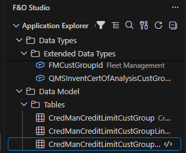
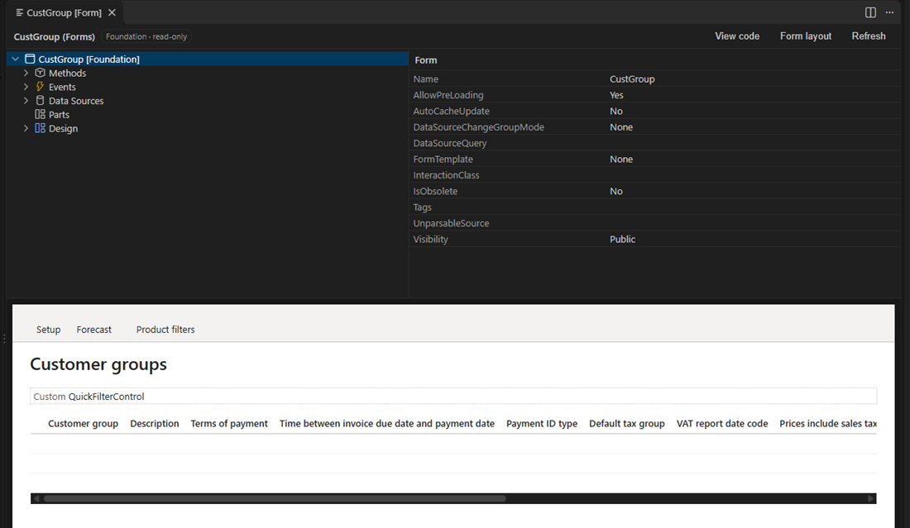
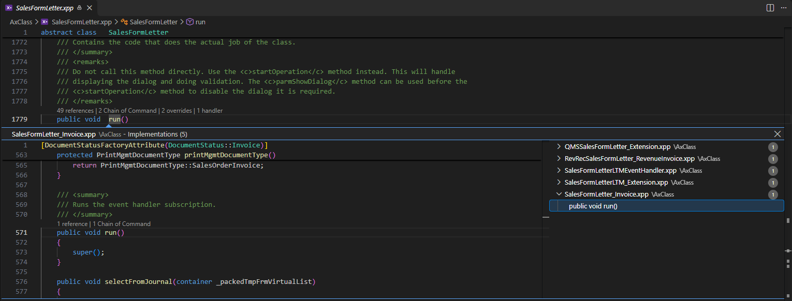
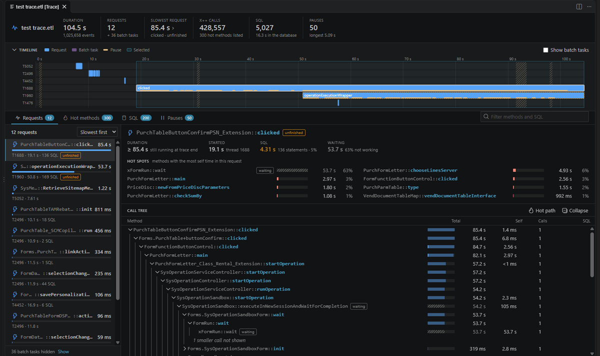

# F&O Studio for VS Code

Develop Dynamics 365 Finance & Operations X++ code in VS Code, without Visual Studio. F&O Studio is for X++ developers on Windows who work on unified developer environments (UDE), cloud-hosted environments or VHD environments.

- **No Visual Studio needed.** You get the Application Explorer, element and form designers, X++ code navigation (including Chain of Command implementations), build, best practice checks, deployment packages, deploy, database sync and the debugger. They use the same metadata API, compiler and scripts as Visual Studio, and projects (`.rnrproj`, `.axpp`) open in both.
- **Copilot works on the real metadata.** The agent tools read, create, extend and build elements through the metadata API. They change only your own models, every write is all or nothing, and you can revert a whole Copilot session.
- **Tools Visual Studio doesn't have:** table data and SQL with query plans, static and live performance analysis, a built-in trace (`.etl`) analyzer, license and segregation-of-duties analysis, upgrade readiness and a pre-deploy checklist.

## What's new in 0.13

**0.13.3: Analyze Trace on VHD environments, Copilot opens code in the editor.** Analyze Trace finds the event manifests on local VHD environments (`AosService\WebRoot\Monitoring` or the registered trace providers), or in the folder set in `xpp.trace.manifestFolder` / `manifestFolder` ([#10](https://github.com/nazmolla/xpp-vscode/issues/10)). The new `xpp_open_element` tool lets Copilot show an element in the X++ code editor or designer, at a method and line, instead of opening its XML. **Open Element…** opens the element when you press Enter before the results appear, and has its own icon.

**0.13.2: Build compiles label files.** LabelC now gets the label file names with their language (`Id_en-US,Id_de` instead of `Id`), so models with label files build, and Build and best practice checks find a model whose package has a different name ([#9](https://github.com/nazmolla/xpp-vscode/issues/9)).

**0.13.1: Analyze Trace for errors and integrations.** The trace analyzer lists every AOS and session in the trace with its user (dual-write, OData, batch, other users), finds errors and exceptions with their full X++ call stack, shows UTC times to match integration logs, and filters by AOS, session, user, method or time window (also in `xpp_analyze_trace`).

Features marked *preview* have not yet been verified on a live environment.

**Daily loop**
- **Code folding** for methods, statements, `case` blocks, comments and `// region` blocks.
- **Build Project** from an X++ editor with `Ctrl+Shift+B`. Unsaved code is saved first, and a failed build offers **Show Problems**.
- **New Element…** works like Visual Studio's Add New Item. It covers every element and extension type plus the wizards, from `+` on the project view.
- **Open Element…** (`Ctrl+Alt+O`) shows recent elements and filters by type prefix (`t:` tables, `c:` classes, `f:` forms).
- **F&O Studio panel:** Results, Infolog and Copilot Activity in one place.
  - Review My Changes, the Pre-Deploy Checklist and Upgrade Readiness show their findings in Results. Click a finding to open it; use **Run Again**, **Copy Report as Markdown** or **Export Report…**.
- **Dynamics 365 view grouped by task:** Environment, Create, Build and check, Deploy, Data, Analyze, Find, Security, Labels, Model and project, Copilot, Debug.
- **Properties grid:** filter, categories, changed values marked, a label picker that finds or creates labels, and element pickers (`Alt+Down`). **Go to Referenced Element…** replaces the separate Go to commands.
- **Browse Table Data** has a record inspector that follows relations to the related rows.
- Element and form designers, the label editor, data tabs and trace tabs come back after a restart.

**Environment and team**
- **Version drift guard** (*preview*): you get a warning when the environment runs a newer application version than the metadata on this machine.
  - **Update Metadata** downloads the new version.
  - **Clean Up Old Application Versions…** frees disk space and keeps the newest older version for Standard Code Drift.
- **Environment setup** shows its steps in the Dynamics 365 view and can retry a failed step. Switching environments no longer needs a window reload.
- **Open Team Repository…** (*preview*) clones a repository, links its packages into your metadata folder and builds them in dependency order.
- **Deployed or not:** the project's status bar item shows when the build is newer than the last deploy from this machine. Run Tests, the debugger and `xpp_run_tests` warn first and offer **Deploy First**.

**Upgrades and review**
- **Standard Code Drift of Wrapped Methods…** shows the standard methods your Chain of Command code wraps that changed between two installed versions, with a diff for each.
- **Upgrade Readiness** also reports collisions with other models' extensions: the same field, index, field group, enum value or form control, and several wrappers of one method.
- **Data entity readiness** in Analyze Performance, Review My Changes and the Pre-Deploy Checklist: public names, keys, staging fields, mandatory fields and set-based processing.
- The **Pre-Deploy Checklist** fails while Run Snippet's scratch class is still in the model.

**Create and test**
- New wizards: **New Business Event…**, **Add Number Sequence…** and **New Feature (Feature Management)…**. **Show Feature Usage** finds where a feature is checked in code.
- **Generate SysTest Class with Test Data (ATL)** builds test data (customers, vendors, items, warehouses) with the Acceptance Test Library and adds the model references it needs.
- **Try Data Entity (OData)…** and **Try Service Operation…** (*preview*) call the active environment and save each request as an `.http` file. Service calls ask first, and the access token is never written to the file.

**Copilot**
- **Checkpoints:** **Start Copilot Checkpoint**, then **Revert Copilot Changes Since the Checkpoint…** to undo every element, label and project change Copilot made.
- **Set Copilot Scope…** limits the elements Copilot may change. The server enforces the scope.
- **Verify Changes in the Running App (Copilot)** (*preview*) turns your changed elements into check steps. Copilot agent mode then runs them with the Dynamics 365 ERP MCP server, which you set up separately.

**Support**
- **Report a Problem…** builds a redacted diagnostics bundle for you to preview and send yourself; nothing is sent automatically. Every command error offers it.
- **Configure Code Intelligence…** turns code intelligence features on or off in one place.
- Kusto snippets (`fno-forms`, `fno-slowforms`, `fno-exceptions`, `fno-events`) for Finance and Operations telemetry in Application Insights.

### Earlier releases
- **0.12:** Browse Table Data and SQL queries (temporary UDE credentials, local AxDB), Analyze Performance with live database insights, Analyze Trace, Upgrade Readiness, wizards (batch job, report, approval workflow, custom service), best practice checks, Review My Changes, the Pre-Deploy Checklist, `@fno` in chat, Copilot Activity, team rules, Test Explorer, build tasks and an accessibility pass.
- **0.11:** Go to referenced elements, F12 in code, element history, drag and drop from the Application Explorer, one workspace per project, server-side write checks.

Full history: [github.com/nazmolla/xpp-vscode](https://github.com/nazmolla/xpp-vscode).

## Features

### Application Explorer and projects
- **Classic view** shows all models' elements by category and type. **Model view** shows each model by display name. Both have a name filter.
- **Clicking an element:**
  - a class opens its code;
  - a label file opens the label editor;
  - any other element opens its designer.
- **Right-click actions:**
  - Open Designer, View Code, Open Form Layout…, Add to Project
  - Create Extension, Create Code Extension (Chain of Command)
  - Find References, View References, View Hierarchy, View Entity Relationship Diagram (ERD)
  - Browse Table Data, Analyze Performance
  - Try Data Entity (OData)…, Try Service Operation…, Show Feature Usage
  - Compare Code…, Compare Metadata…, Open in Browser, Open Table Browser
  - On your own models: Upgrade Readiness and Standard Code Drift of Wrapped Methods…
- **Projects** (optional):
  - **Open D365FO Project…**, **Open Recent D365FO Project…**, **Create D365FO Project…** (writes `.rnrproj` and `.slnx` like Visual Studio), **Export Project…** and **Import Project…** (`.axpp`, the same format as Visual Studio).
  - Each project opens in its own workspace with its project and model folders.
  - The project view follows the `.rnrproj`, so elements added by Copilot or Visual Studio show up on their own. It marks git changes.
  - **Exclude from Project** keeps the element in the model. **Delete** removes it from the model (your own models only).
- **Models:** **Create Model…**, **Update Model Parameters…**, **View Model Dependencies…**.

### Create elements
- **New Element…** (`+` on the project view and its folders) is Visual Studio's Add New Item: classes, tables, EDTs, enums, forms, menu items, security objects and every extension type.
- **Wizards** create complete standard patterns in your project's model. Each one is all or nothing, and each result compiles without warnings.
  - **New Batch Job:** SysOperation contract, service and controller, plus an action menu item and a privilege.
  - **New Report:** TempDB table, optional date contract, report data provider, controller, report with a ready-to-run design, output menu item and privilege.
  - **New Approval Workflow** on one of your tables: status, document, category, type, approval, event handlers, menu items, privileges and the form's workflow settings.
  - **New Custom Service:** request and response contracts, service class, service, service group and privilege.
  - **New Business Event…:** event and contract classes, a trigger, and labels for the catalog.
  - **Add Number Sequence…:** the module's number sequence reference, the parameters method and the number fetched on insert.
  - **New Feature (Feature Management)…:** the feature class and its labels.

### Element designer
- **Node tree and Properties grid** for every element type. They are built from the same metadata classes as Visual Studio's designer, with the same node order and icons.
- **Properties grid:** filter, categories, changed values marked, label picker (find or create) and element pickers (`Alt+Down`). **Go to Referenced Element…** opens what a property points to.
- **Editing:** New (any node type a folder accepts), New Method…, Override Method…, Rename…, Duplicate…, Move Up and Move Down, Delete, and **Add from Application Explorer…** (or drag and drop, with Visual Studio's drop rules). Undo with `Ctrl+Z` and redo with `Ctrl+Y`.
- **Events:** **Copy Event Handler Method** (or double-click) puts Visual Studio's handler code on the clipboard. **Find Event Handlers** lists the existing ones.
- **Forms:** a preview drawn like the web client, with Table of Contents and FastTab patterns, columns and field labels.
- **Extensions** show the base element's nodes; the extension's own nodes are in bold. Elements outside your models are read-only, and the editor title offers **Create Extension**.
- **Entity relationship diagram:** choose the levels, the direction and the fields shown. Export it as SVG or Mermaid.
- **Label editor:** search, other languages side by side, New, Edit and Delete in every language, and Copy @reference.

### Code
- **Code view:** a class looks the way Visual Studio shows it, with the declaration and then the methods inside its braces. Methods of data sources, fields and controls open in their own editor.
- **Code folding** for methods, statements, `case` blocks, block and doc comments, and `// region` blocks.
- **Navigation:**
  - Go to and Peek Definition (`F12`) on element names, `Type::method`, `this.`, `super.` and `variable.method()`.
  - **Find All References** (`Shift+F12`) uses the cross-reference database.
  - Hover shows the element, the label text or the method signature.

### Code intelligence
Turn each feature on or off with **Configure Code Intelligence…**, or with the `xpp.codeIntelligence.*` settings.
- **Outline and breadcrumbs.** **Go to Symbol in Workspace** (`Ctrl+T`) finds elements and `Class.method`.
- **Go to Implementations** (`Ctrl+F12`) lists overrides, Chain of Command classes and methods, and pre/post and event handlers. **Show Extensions and Handlers…** and **Rebuild Extension Index** run from the command palette.
- **Code lens** above classes and methods shows references, overrides, Chain of Command classes and handlers.
- **Call hierarchy** and **type hierarchy**.
- **Completion** after `.` and `::` (including methods added by Chain of Command), for `@` labels and for keywords, plus **signature help**.
- **Checks and formatting:**
  - syntax errors while you type (the X++ compiler's parser);
  - warnings on `[SysObsolete]` APIs;
  - Format Document;
  - optional compile on save and semantic highlighting (both slower, off by default);
  - an event handler index for form and data events, which the cross-reference database doesn't record.

### Productivity
- **Search Code in All Packages** (`Ctrl+Shift+Alt+F`): text or regex search over every package's X++ code.
- **Find Similar Standard Implementations:** standard elements like the selected one, or matching a description such as "batch job with contract".
- **Find Message Source:** paste an error, warning or info message as the user saw it, values included, to find the labels and the code that raises it. It's also on every Infolog message.
- **Quick fixes** (`Ctrl+.`):
  - extract to label;
  - generate `find()` and `exist()`;
  - implement missing interface methods;
  - create a Chain of Command wrapper.
- **Add to Privilege…**, **Generate SysTest Class**, **Generate SysTest Class with Test Data (ATL)**, and **Run Snippet in Environment**, which runs a `main` method through a scratch class in your model.
- **Snippets** for Chain of Command, event handlers, SysOperation, find/exist, parm methods, transactions with retry and SysTest, plus Kusto snippets for telemetry.

### Build, test, deploy and debug
- **Build:**
  - **Build Project** (`Ctrl+Shift+B` in an X++ editor, or the status bar) reports only the project's problems. **Build Model** covers the whole model.
  - Builds use xppc and LabelC, and errors go to Problems at the right line.
  - Unsaved code is saved first (`xpp.build.saveBeforeBuild`). A failed build offers **Show Problems**.
- **Build tasks:** `{ "type": "xpp", "action": "buildProject" }` (or `buildModel`) in `tasks.json`.
- **Run Tests:**
  - runs SysTest classes on the environment, like Visual Studio's Test Explorer;
  - the project's test classes also appear in VS Code's **Test Explorer**;
  - tests run the deployed code, and you get a warning when your build is newer than the last deploy.
- **Deploy:**
  - **Create Deployment Package…** (the same script Visual Studio runs);
  - **Deploy Models to Environment (pac)**, **Synchronize Database (pac)**, **Initialize Deployment Solution (pac)**;
  - **Synchronize Tables** syncs only your project's tables on cloud-hosted and VHD environments.
- **Debugging:**
  - **Launch Debugger** attaches through the FinOps debugger proxy, as Visual Studio does, and you can set breakpoints in the code view.
  - **Infolog** shows the debugged code's messages, each linked to Find Message Source.
- **Status bar:** project and last build result, deployed state, X++ server state (click to restart) and database.

### Data
- **Browse Table Data** (right-click a table, or from its designer):
  - enum names next to their values;
  - company filter, and an as-of date for date-effective tables;
  - column filters, sorting, a row limit and Export CSV;
  - a record inspector that follows relations.
  - **Open as SQL** turns the view into an editable query.
- **New SQL Query:**
  - read-only by default: one SELECT, always rolled back;
  - **Explain Plan** shows the query plan;
  - **Allow changes** commits after a confirmation each run, with a warning that X++ business logic is skipped.
- **Database access:**
  - Cloud-hosted and VHD environments use the local AxDB with Windows authentication.
  - Unified developer and sandbox environments use temporary credentials from **Request Database Credentials**, the same request Visual Studio makes. They are kept in VS Code's secret storage until they expire.
  - **Open Database in SQL Server Management Studio** opens SSMS on the same database.

### Performance and traces
- **Analyze Performance** (classes, tables, forms, data entities) puts findings in Problems with the fix. It finds:
  - queries and row-by-row writes inside loops;
  - lookups inside `while select`, and `while select` of every field;
  - `forupdate` without a write, and unbalanced transactions;
  - unlimited `crossCompany`;
  - set-based statements that silently run row by row;
  - missing indexes and cache settings;
  - data entity readiness problems.
- **Database Performance Insights** (needs database access): missing indexes, the most expensive queries, batch job history, and number sequences that slow posting.
- **Analyze Trace…** reads a web client trace (`.etl`) with F&O Studio's own parser; no Trace Parser and no import database. It shows:
  - requests on a timeline, per AOS and thread, with UTC times to match integration logs;
  - every AOS and session in the trace with its user (other users, dual-write and OData integrations, batch), one click to filter on it;
  - errors and exceptions with the full X++ call stack (`Global::error`, `checkFailed`, `warning`, and frames unwound by an exception with the method that caught it);
  - call trees, hot methods and SQL per method;
  - pauses;
  - each method one click from its code.
- `xpp_analyze_trace` takes the same filters for agents: `aos`, `session`, `user`, `method` (requests that reach it, with the path) and `from`/`to` (UTC times).
- **Telemetry Queries (Application Insights KQL):** the most used and slowest forms, X++ exceptions and custom events. On a form, the queries are filtered to that form.

### Review, release and upgrades
- **Run Best Practice Checks on Project** runs xppbp, the checker Visual Studio runs, and puts its warnings in Problems.
- **Review My Changes** lists the elements changed against `xpp.git.baseBranch`, each with its best-practice and performance findings, plus a pull request summary to copy. **Show Changed Elements** lists the same elements.
- **Pre-Deploy Checklist** checks, in one report:
  - build, best practice and performance;
  - security gaps and unlabelled text;
  - uncommitted changes;
  - Run Snippet's scratch class left in the model.
- **Upgrade Readiness:**
  - uses of `[SysObsolete]` APIs, with the replacement the attribute names;
  - Chain of Command wrappers, event handlers, and table, form and enum extensions that no longer match the installed application;
  - collisions with other models' extensions.
- **Standard Code Drift of Wrapped Methods…** compares the standard methods you wrap between two installed versions, with diffs.

### Security and licensing
- **Security view:** your models' roles and the standard roles they extend, each with its user license. Expand a role down to its entry points and grants.
- **Analyze License** shows the license a role, duty or privilege needs, what drives it, and where read-only access would lower it.
- **Who Can Access** shows the privileges, duties and roles that reach a menu item, form, table or data entity.
- **Find Security Gaps** and **Check Segregation of Duties**. **Edit Segregation of Duties Rules** writes the rules to a file you can change.
- **Security Report…** for sign-off, as Markdown or CSV.

### Integration
- **Try Data Entity (OData)…** (*preview*) queries an entity on the active environment.
- **Try Service Operation…** (*preview*) calls a custom service with a request body filled from its data contract.
- Both save the request as an `.http` file. The access token is never written to the file.

### Labels and refactoring
- **Find Labels…**, **Translate Missing Labels…** (you review each translation before it is saved) and **Find Unused Labels…**.
- **Rename…** (`F2`) on a method of your models updates its calls, after a preview.

### Environments
- **Connect to Environment…** downloads the metadata, restores the cross-reference database and configures the machine. It shows each step and can retry a failed one.
- **Select Environment…** (also from the status bar) switches environments without a reload.
  - Each workspace remembers its own environment, so two windows can work with two environments.
  - **Sign In to Environment (pac)** keeps one pac profile per environment.
- **Version drift guard** (*preview*): you get a warning when the environment runs a newer application version. **Update Metadata** downloads it, and **Clean Up Old Application Versions…** removes old versions after a confirmation.
- **Open Team Repository…** (*preview*): clone or pick a repository, link its packages into the metadata folder and build them in dependency order.
- **Cloud-hosted and VHD environments** work without a connection step. F&O Studio uses the local PackagesLocalDirectory, AOS and AxDB. Deploy (pac), Run Tests and the debugger are UDE-only and are hidden there.

### Copilot
- **@fno** in Copilot Chat: `/design`, `/extend`, `/explain`, `/review`, `/support`, `/performance`.
- **Copilot Activity** shows every tool call agents make, with arguments, duration and result. Changed elements link to their designer.
- **Checkpoints and scope:**
  - **Start Copilot Checkpoint**, then **Revert Copilot Changes Since the Checkpoint…** or **End Copilot Checkpoint (Keep Changes)**;
  - **Set Copilot Scope…** limits the elements Copilot may change. The server enforces both.
- **Create Team Rules for Copilot** creates `.xpp/agent-rules.md`, which is added to the agent instructions of everyone working in the repository.
- **Verify Changes in the Running App (Copilot)** (*preview*) plans checks from your changes and runs them through the Dynamics 365 ERP MCP server.

### AI agent tools (MCP)
The tools are registered automatically. Copilot can:
- **Read and write metadata:** read, create, update, validate and delete elements.
  - Writes are limited to your own models and are all or nothing.
  - An existing name is never overwritten.
  - Large objects are read as a summary first.
- **Extend standard objects:** table, form, enum, EDT, menu, security and data entity extensions. Form controls are placed and checked against the form's patterns. Entity extensions include their staging tables.
- **Find precedents:** find standard implementations to follow (`xpp_find_examples`), search all code (`xpp_search_code`), and find references with the calling code (`xpp_find_references`).
- **Check its work:** best-practice warnings come back after every write.
  - The agent's plan names a standard precedent for each object and includes a class design.
  - `xpp_build`, `xpp_check_best_practice` and `xpp_analyze_performance` check the result.
- **Analyze:** security and licenses (`xpp_analyze_security`), messages (`xpp_find_message_source`), traces (`xpp_analyze_trace`), and upgrades and collisions (`xpp_find_deprecations`).
- **Test and release:** run tests on the environment (`xpp_run_tests`), list branch changes (`xpp_diff_changes`) and create a deployment package (`xpp_package`).
- **Read data:** `xpp_query_data` runs one read-only, row-limited SELECT after your confirmation. The agent never sees credentials.
- **Read documentation:** search Microsoft Learn, and load the full development guide on demand (`xpp_get_guide`), including Acceptance Test Library tests.

## Compared with Visual Studio

**Same** means the same compiler, script, file format or metadata API. **Different** means another way to get the same result.

| Visual Studio | F&O Studio | |
| --- | --- | --- |
| Application Explorer (classic and model view) | Application Explorer | Same |
| Solution Explorer: Add > New Item | New Element… and the wizards | Same element types, plus batch job, report, workflow, service, business event, number sequence and feature wizards |
| Element designers and the Properties window | Element designer with a filterable, categorized Properties grid and pickers | Same metadata classes |
| Form designer | Form layout preview, form extensions, element designer for the nodes | Different: no design surface for new forms |
| Code editor | X++ code view with completion, definitions, references, Chain of Command implementations, code lens, folding and formatting | Same code layout |
| Build models, build project | Build Model, Build Project; errors in Problems | Same (xppc, LabelC) |
| Best practice checks | Run Best Practice Checks on Project | Same (xppbp) |
| Synchronize database | Synchronize Database (pac on UDE, SyncEngine on cloud-hosted and VHD), Synchronize Tables | Same |
| Create deployment package, deploy | Create Deployment Package…, Deploy Models to Environment (pac) | Same |
| Model management | Create Model…, Update Model Parameters…, View Model Dependencies… | Same |
| Import/Export project (.axpp) | Import Project…, Export Project… | Same file format |
| Find references, metadata search, find labels, tag references | Find References, Open Element…, Find Labels…, Find Tag References… | Same cross-reference database |
| Compare | Compare Code…, Compare Metadata… in VS Code's diff editor | Different view, same content |
| Launch debugger (UDE) | Launch Debugger (DebuggerProxy with vsdbg) | Attaches; breakpoint hits not yet verified |
| Infolog | Infolog in the F&O Studio panel | Same messages |
| Test Explorer (SysTest) | Test Explorer and Run Tests | Same runner on the environment |
| DGML diagrams | Hierarchy, references and entity relationship diagrams | Different |
| Trace Parser | Analyze Trace… (own `.etl` reader, no import database) | Different |
| Open in browser, table browser | Open in Browser, Open Table Browser, Browse Table Data, SQL queries | More |
| Report designer (.rdl) | New Report wizard with an automatic design | Not available: design layouts in Visual Studio |
| Table + form and data entity wizards | New Element… and the agent tools | Planned |

## Requirements

- Windows, VS Code 1.101 or later.
- One of these environments:
  - **Unified developer environment:** **Connect to Environment…** installs the metadata, compiler and FinOps tools.
  - **Cloud-hosted or VHD environment:** run VS Code as administrator, as Visual Studio does, to build into PackagesLocalDirectory.
- SQL Server LocalDB, for cross references.
- [Power Platform CLI](https://learn.microsoft.com/power-platform/developer/cli/introduction) (`pac`), for deploy and database sync on a UDE.
- GitHub Copilot, for `@fno` and the agent tools. Verify Changes in the Running App also needs the Dynamics 365 ERP MCP server.

## Getting started

1. Open the **F&O Studio** view in the activity bar, or the **Get started with F&O Studio** walkthrough.
2. Set up the machine:
   - **Unified developer environment:** run **Connect to Environment…** from the Environment group of the Dynamics 365 view.
   - **Cloud-hosted or VHD environment:** there is nothing to set up.
3. Pick your starting point:
   - **Team repository:** **Open Team Repository…** links its packages and builds them.
   - **Your own project:** **Open D365FO Project…** or **Create D365FO Project…**. A project is optional.
   - **Just browsing:** use the **Application Explorer**.
4. Open elements (`Ctrl+Alt+O`), build (`Ctrl+Shift+B`), browse data, or ask Copilot in agent mode (or `@fno` in chat). Start a Copilot checkpoint first if you want to be able to revert.

## Settings

| Setting | Description |
| --- | --- |
| `xpp.project` | The project (`.rnrproj`) of a project workspace. Open D365FO Project writes it; it is ignored in user settings |
| `xpp.environmentUrl` | Dataverse URL of your default unified developer environment. Select Environment… picks one per workspace |
| `xpp.financeAndOperationsUrl` | Web client URL for Open in Browser and Open Table Browser, used when the environment's configuration has none |
| `xpp.auth.clientId` | Optional Microsoft Entra app ID for sign-in |
| `xpp.build.crossReference` | Update cross references while building |
| `xpp.build.runAppCheckerRules` | Run AppChecker rules during the build |
| `xpp.build.saveBeforeBuild` | Save unsaved X++ code views before a build |
| `xpp.pacPath` | Path to `pac` |
| `xpp.debuggerProxyPath` | Path to `Microsoft.Dynamics.AX.DebuggerProxy.exe`, if it isn't in the default location |
| `xpp.erd.depth`, `xpp.erd.direction`, `xpp.erd.fields` | Defaults for the entity relationship diagram |
| `xpp.security.sodRulesFile` | Segregation of duties rules (JSON); leave empty to use the built-in rules |
| `xpp.codeIntelligence.*` | Turn code intelligence features on or off (`outline`, `navigation`, `workspaceSymbols`, `completion`, `hover`, `codeLens`, `syntaxCheck`, `obsoleteWarnings`, `formatting`, `eventHandlerIndex`, `semanticHighlighting`, `diagnosticsOnSave`) |
| `xpp.git.baseBranch` | The branch Review My Changes and Show Changed Elements compare with |
| `xpp.usageStatistics` | Count command use on this machine only; nothing is sent. Show Usage Statistics lists the counts |

## Status

This extension is a preview. Some features have not been verified end to end on a live environment:
- debugger breakpoint hits;
- the version drift guard;
- Open Team Repository on a real team repository;
- Try Data Entity and Try Service Operation;
- Verify Changes in the Running App.

To report a problem, use **Report a Problem…** or open an issue on [GitHub](https://github.com/nazmolla/xpp-vscode/issues).

Licensed under the [Apache License 2.0](https://github.com/nazmolla/xpp-vscode/blob/main/LICENSE).

*F&O Studio is an independent project and is not affiliated with or endorsed by Microsoft. Dynamics 365 is a trademark of Microsoft Corporation.*

