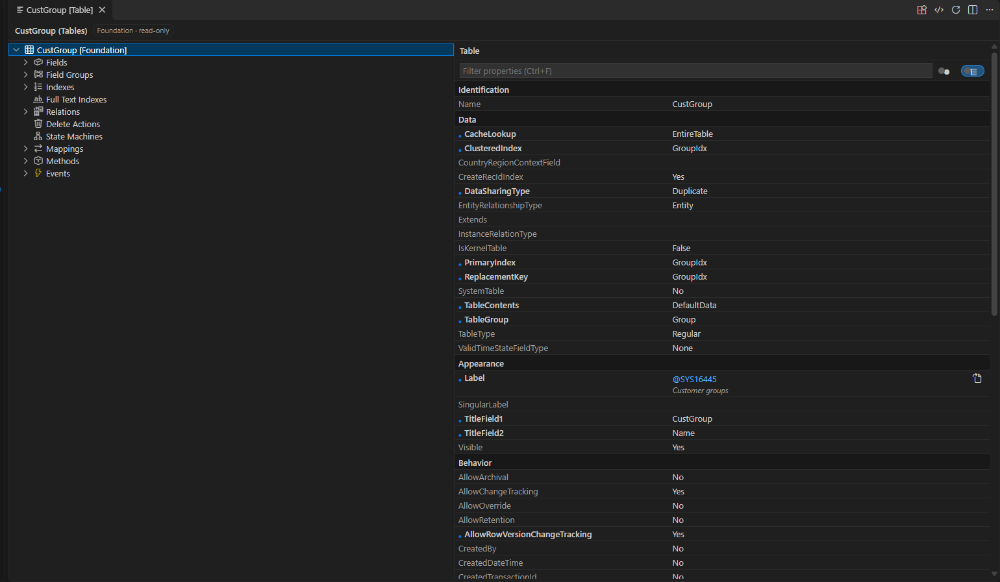
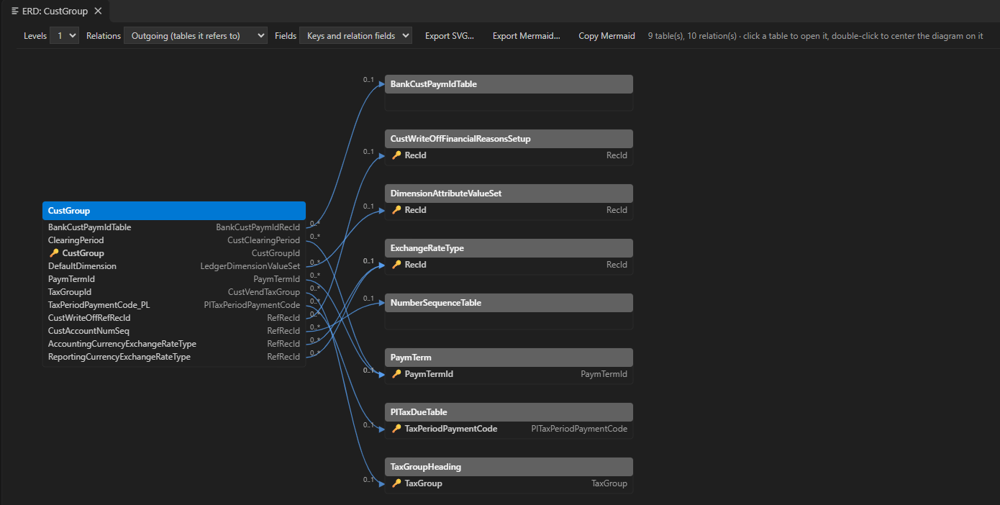
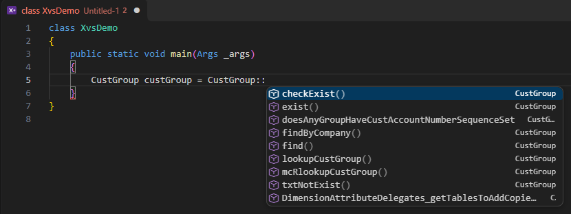

# F&O Studio: feature reference

### Application Explorer
- **Classic view** (elements of all models grouped by category and type) and **model view** (each model by display name), with a name filter.
- Click a class to open its code; a label file opens the **label editor**; any other element opens its designer.
- **Right-click actions:**
  - Open Designer, View Code, Open Form Layout.
  - Add to Project, Create Extension, Create Code Extension (Chain of Command).
  - Find References, View References (every reference opens the code at its line), View Hierarchy, View Entity Relationship Diagram (tables).
  - Compare Code, Compare Metadata.
  - Open in Browser, Open Table Browser.

### Element designer
- **Node tree and Properties grid** for every element type, generated from the metadata classes Visual Studio's designer uses.
- **Looks like Visual Studio's designer:** the same node order and icons for every element type; a class lists its methods, an enum its values.
- **Right-click on the element itself** offers the Application Explorer actions (references, extensions, compare, ERD...).
- **Events nodes** on tables, data entities, forms, form data sources, fields and controls: **Copy Event Handler Method** (or double-click) puts Visual Studio's handler on the clipboard; on a method it writes a Pre/Post handler or a delegate subscriber. **Find Event Handlers** lists the existing handlers.
- **Entity relationship diagram** (ERD) of a table and its related tables: choose the levels, outgoing/incoming relations and the fields shown; double-click a table to centre on it; export SVG or Mermaid.
- **Right-click actions:** New (any node type a folder accepts, such as fields, field groups, indexes, relations, data sources and controls), New Method, Override Method, Delete.
- **Forms:** a preview rendered like the web client, with Table of Contents and FastTab patterns, column layout, field labels from EDTs and toggles for Yes/No fields.
- **Extensions** show the base element's nodes with the extension's own nodes in bold; the base nodes are read-only.
- **Read-only for others' elements:** elements outside your models can be viewed but not changed; extend them instead.
- **Label editor:** label ID, text and comment, with search and the label file's other languages side by side; New label, Edit, Delete (every language) and Copy @reference for your own label files. Properties opens the property grid.

### Code
- **Code view** shows a class the way Visual Studio does: the declaration, then the methods inside its braces. Objects in your own models are editable.
- **Methods of nested nodes** (data sources, fields, controls) open in their own editor.
- **Navigation:** Go to / Peek Definition (F12) for element names and members: `Type::method`, `this.`, `super.`, `variable.method()` (the variable's declared type), and calls to methods of the object or its base classes. **Find All References** (Shift+F12) uses the cross-reference database. Hover shows the element or the method signature.

### Code intelligence
Each feature can be turned on or off under **Code intelligence** in the Dynamics 365 view, or with the `xpp.codeIntelligence.*` settings. Features marked *slow* use more CPU or disk.
- **Outline** and breadcrumbs for classes, tables and forms; **Go to Symbol in Workspace** (`Ctrl+T`) for elements and `Class.method`.
- **Chain of Command:** **Go to Implementations** (`Ctrl+F12`) on a class or method lists overrides, CoC extension classes, the CoC methods that wrap it, and Pre/Post and event handlers (form and data events too). The index is built from the cross-reference database in a few seconds and kept on disk, so asking "what extends this method" never blocks the editor. **Show Extensions** and **Rebuild Extension Index** are in the Dynamics 365 view.
- **Code lens** above each class and method: references, overrides, CoC classes and handlers.
- **Call hierarchy** and **type hierarchy** (base classes and subclasses).
- **Completion** after `.` and `::` (fields, methods of the type and its base types, methods added by CoC extensions), `@` labels and keywords; **signature help** for method calls.
- **Hover** shows label text, EDT details and enum values.
- **Syntax errors** while typing (X++ compiler parser), **compile on save** (*slow*, off by default), **formatting** (Format Document / Selection) and **semantic highlighting** (*slow*, off by default).
- **Event handler index** (*slow*): scans class files for form and data event handlers, which the cross-reference database doesn't contain.
- **Obsolete API warnings:** calls to methods and uses of classes and tables marked `[SysObsolete]` show in Problems.

### Productivity
- **Search Code in All Packages** (`Ctrl+Shift+Alt+F`): text or regex search over the X++ code of every package; a result opens the method at the matching line.
- **Find Similar Standard Implementations:** standard elements like the selected one, or matching a description such as "batch job with contract".
- **Find Message Source:** paste an error, warning or info message as the user saw it, values included. It finds the labels whose text matches (placeholders match any value) and the code that raises them, from the cross-reference database; a result opens the line. Also on every message in the Infolog view.
- **Quick fixes** (`Ctrl+.`): Extract to label, Generate find() and exist() on your tables, Implement missing interface methods, Create Chain of Command wrapper on methods of standard objects.
- **Add to Privilege** for menu items, **Generate SysTest Class** for classes, and **Run Snippet in Environment** (runs a `main` method from an untitled X++ editor through a scratch class in your model).
- **Snippets** for Chain of Command, event handlers, SysOperation, RunBaseBatch, find/exist, parm methods, transactions with retry and SysTest.

### Security and licensing
- **Security view:** the roles of your models and the standard roles they extend, each with its user license, and all roles (with a name filter). Expand a role to see its sub-roles, duties, privileges and entry points with their grant and license.
- **Analyze License** on a role, duty or privilege: the license it needs (from the View or Maintain user license of the menu items it grants, depending on the access), the entry points per license, the menu items that drive it and through which duties and privileges, the menu items where read-only access would lower it, and missing objects.
- **Who Can Access** on a menu item, form, table or data entity: the privileges that grant it, with their duties and roles, and the licenses of its menu items.
- **Find Security Gaps** in your models (for example menu items no privilege grants), grouped by severity.
- **Segregation of Duties:** finds roles that combine conflicting duties. The rules are editable: **Edit Segregation of Duties Rules** writes the built-in rules to `.xpp/sod-rules.json` and uses that file (`xpp.security.sodRulesFile`).
- **Security Report** for sign-off: roles, duties, privileges, entry points and licenses as Markdown or CSV.
- Results open in a panel with clickable objects, Copy as Markdown and Export.

### Build, deploy and debug
- **Build Model** with the X++ compiler (`Ctrl+Shift+B`), and **Build Project**, which reports only the problems in the project's objects. Errors appear in the Problems panel at the right line. A compiler crash (Fatal) or a missing output assembly fails the build.
- **Run Tests:** runs SysTest test classes on the environment the way Visual Studio's Test Explorer does, and shows each test's result. Tests run against the deployed code, so build and deploy first. The project's test classes also appear in VS Code's **Test Explorer**.
- **Build tasks:** `{ "type": "xpp", "action": "buildProject" }` (or `buildModel`) in `tasks.json` runs the same build, to chain it with other tasks.
- **Status bar:** the project with its last build result (click to build), the X++ server while it starts or after it stopped (click to restart), and the database.
- **Create Deployment Package** (the same script Visual Studio runs), Deploy Models and Synchronize Database (with `pac`).
- **Launch Debugger:** attaches to the environment through the FinOps tools' debugger proxy, as Visual Studio does. Breakpoints can be set in the code view.
- **Infolog:** messages raised by the code being debugged; **Find Message Source** on a message opens the code that raised it.

### Data
- **Browse Table Data** (right-click a table, or in its designer): the table's rows with enum names next to their values, a company filter, an as-of date for date-effective tables, column filters, sorting, a row limit and Export CSV. **Open as SQL** turns the view into an editable query; **Open in SQL Server Management Studio** opens SSMS on the same database.
- **New SQL Query:** read-only by default (one SELECT, run in a transaction that is always rolled back). **Allow changes** commits the batch after a confirmation each run; changes made in SQL skip X++ business logic (insert/update methods, validation, database log, events, caches).
- **Cloud-hosted and VHD environments** use the local AxDB with Windows authentication. **Unified developer and sandbox environments** use temporary credentials: **Request Database Credentials** asks for a reason, the allowed IPv4 address (prefilled) and Reader or Writer access, the same request Visual Studio's "SQL Credentials for Dynamics 365 FinOps" makes (System administrator role needed). New credentials replace earlier ones, Visual Studio's included. They are kept in VS Code's secret storage until they expire and are never written to settings or logs. The status bar shows the database and when access expires.

### Dynamics 365 tools
- **Analyze Performance** (classes, tables, forms; also in the code view's context menu): queries and row-by-row writes inside loops, single-row lookups inside `while select`, `while select` of every field, `forupdate` without a write, unbalanced transactions, unlimited `crossCompany`, and `insert_recordset` / `update_recordset` / `delete_from` that silently run row by row (overridden methods, delete actions, date-effective tables). Findings go to the Problems view with the fix.
- **Upgrade Readiness** (right-click one of your models): every use of an obsolete (`[SysObsolete]`) class, table or method, with the replacement the attribute names; and every extension of the model checked against the installed application: Chain of Command wrappers whose method is gone, changed its signature or can no longer be wrapped (private, final, `Wrappable(false)`, `Hookable(false)`, internal), event handlers whose class, method, delegate or table is gone, and table, form and enum extensions whose base element, fields, field groups or controls are gone. Run it on the version you upgrade to, before building.
- **Model management:** Create Model, Update Model Parameters, View Model Dependencies.
- **Projects:** Open Project, **Open Recent Project**, Close Project, **Create D365FO Project** (for one of your models; writes the `.rnrproj` and `.slnx` like Visual Studio), Export Project and Import Project (`.axpp`, compatible with Visual Studio). Opening a project opens its own workspace with the project folder and the model folder; other windows have no project, and VS Code starts without one (File > Open Recent lists project workspaces too). The project view follows the `.rnrproj`, so elements added by agents or other editors appear by themselves. In the project view, **Exclude from Project** keeps an element in the model; **Delete** removes it from the model (your own models only).
- **Search:** Find Labels, Find Tag References, Metadata Search, Find References, Search Code, Find Similar Standard Implementations, Find Message Source.
- **Environment:** Connect to Environment (downloads metadata, restores the cross-reference database, configures the machine), Select Environment, Check Connection, Sign in.
- **Several environments:** connect to each one once; **Select Environment** (also in the status bar) switches between them. Each workspace remembers its own environment, so two windows can work with two environments at the same time. The choice is kept out of the workspace's settings files, since every developer has an environment of their own; `xpp.environmentUrl` is the default for workspaces that haven't chosen one. Metadata, cross references, build, MCP tools, deploy, database sync, tests, debugging and Open in Browser all follow the selected environment. **Sign In (pac)** creates a pac profile named after the environment, which deploy and database sync select first, so environments in different tenants keep their own accounts. If the selected environment's metadata isn't on this machine, the tools fall back to the machine-wide configuration (shared with Visual Studio) and the status bar shows a warning.
- **Cloud-hosted and VHD environments:** with no unified developer environment configured, the extension uses `K:\AosService\PackagesLocalDirectory` (cloud-hosted) or `C:\AosService\PackagesLocalDirectory` (VHD, which has only a C: drive) with no connection step. Database, cross-reference database and web client URL come from the AOS `web.config`. Your models are the ones in packages not published by Microsoft; only those can be edited, by you or by agents. ISV packages there count as yours too. Build writes to the local AOS and **Synchronize Database** runs SyncEngine against the local database; deploy (pac), Run Tests and the debugger are UDE features and are hidden there.

### Review and release
- **Best Practice Check** (`xppbp`, the checker Visual Studio runs): warnings of your model in the Problems view.
- **Review My Changes:** the elements changed on your branch against `xpp.git.baseBranch`, each with its best-practice and performance findings, and a pull request summary to copy.
- **Pre-Deploy Checklist:** build, best practice, performance, security gaps, unlabelled texts and uncommitted changes in one report before you create a deployment package.
- **Synchronize Tables:** synchronizes only the tables of your project with the local database (cloud-hosted and VHD).
- **Live insights** (with database access): missing indexes, the most expensive queries from Query Store, batch job history and number sequences that slow posting (continuous or without preallocation).
- **Explain Plan** in the SQL query panel.
- **Analyze Trace** (also on `.etl` files in the Explorer): reads a trace taken in the web client (Settings > Trace) with F&O Studio's own parser, no Trace Parser or SQL import needed. Shows each request (web request or batch task) with its call tree, inclusive and exclusive time and SQL per method; methods by exclusive time; SQL statements with the X++ method that ran them; and pauses where a request or the whole server logged nothing. Every method opens in the code view. Agents get the same as `xpp_analyze_trace`.
- **Telemetry Queries:** KQL for the telemetry Finance and Operations sends to Application Insights (most opened and slowest forms, X++ exceptions, custom events); on a form, filtered to that form.

### Labels and refactoring
- **Translate Missing Labels:** fills the languages a label file lacks with a language model; you review every translation before it is saved.
- **Find Unused Labels:** labels of your label files that neither code nor metadata use.
- **Rename** (`F2`) on a method of your models renames it and its calls, after a preview; methods of standard models are refused.
- **Hover** on an element name shows its label and links to its designer and references.

### Copilot
- **@fno** in Copilot Chat: `/design` (solution design with standard precedents), `/extend` (how to extend a standard object), `/explain`, `/review`, `/support` (from an error message to the code) and `/performance`.
- **Copilot Activity** view: every tool call agents make, with arguments, duration and result; changes link to the element.
- **Team rules:** `.xpp/agent-rules.md` (created by **Create Team Rules**) is added to the agent instructions of everyone working in the repository.
- **Wizards** that create complete, compiling standard patterns in your project's model (all or nothing):
  - **New Batch Job:** contract, service and controller (SysOperation), action menu item and privilege.
  - **New Report:** a report over a table's fields: TempDB table, optional From/To date contract, report data provider filling it set-based, controller, the report with its data set and a ready-to-run table design, output menu item and privilege.
  - **New Approval Workflow** on one of your tables: status enum and field, `canSubmitToWorkflow`, document query and class, workflow category, type and approval, event handlers, submit/resubmit class, the workflow action menu items, privileges for submitters and approvers, and the form's workflow settings.
  - **New Custom Service:** request and response contracts, service class, service, service group and a privilege for the operation.

### AI agent tools (MCP)
Copilot can:
- read, create, update and validate metadata. Every create is all-or-nothing, an existing name is never overwritten, and any request that is not fully applied returns an error (`typedMetadata` items take `"$type"` for subtypes, as `xpp_read_object` writes them). Large objects are read as a summary first; ask for parts with `sections`;
- change existing table fields (EDT, label, help text, properties), and remove fields, indexes, field groups and relations. A field's base type never changes (as in Visual Studio: the database sync cannot convert a column), so a different type needs a new field name, and a removed field name never comes back with another type;
- report best-practice warnings after every create and update (missing labels or EDTs, literal texts, missing keys, indexes and caching on tables, menu items no privilege grants, Chain of Command class naming, classes that are too large or mix validation with posting); the agent's plan includes a best-practice review of the design and a class diagram with one responsibility per class (validator, reusable services, an orchestrator);
- find elements and their references; security roles, duties and privileges are also found by their label text;
- find how standard code does it, which is how X++ is developed: `xpp_find_examples` (standard implementations for a task such as "batch job with a contract" or "number sequence", forms with a pattern, or objects similar to a given one), `xpp_search_code` (text or regex over the code of every package), and `xpp_find_references` with `includeCode` (the calling code lines). The agent's plan names the standard precedent of every object and reuses it, extends it, or copies it only when it cannot be reused;
- create label files, and many labels with translations in one call, and add elements to the project;
- form extensions: controls are placed and checked against the form's patterns (a new tab page gets the pattern its place expects, required values are set, unknown pattern versions become the latest; anything the build would reject is refused, and the check takes seconds even on SalesTable), properties of base controls are changed only where D365FO allows it, and the extension's own controls can be updated, moved and removed;
- create and update menu items, create menu extensions, and work with security privileges, duties and roles;
- analyze security with `xpp_analyze_security`: the license of a role, duty or privilege and what drives it, who can access an object, the standard roles to give a new duty (requirements name roles by job title: it ranks the roles that already reach the same objects), security gaps, segregation of duties conflicts and the sign-off report;
- trace a message to the code that raises it with `xpp_find_message_source` (label text with values, then where the label is used);
- create data entity extensions, including their staging tables, also on entities built on other entities or views; create composite data entities;
- delete elements of your own models (refused while other elements reference them; their cross-reference entries are removed) or exclude them from the project;
- select the active project, build the model and read every compiler error;
- run X++ unit tests on the environment (`xpp_run_tests`);
- read business data with `xpp_query_data` (one read-only SELECT, row-limited, after your confirmation; the agent never sees the credentials);
- review performance with `xpp_analyze_performance`, performance traces with `xpp_analyze_trace`, and upgrade readiness with `xpp_find_deprecations`;
- run the best-practice checker (`xpp_check_best_practice`), list the elements changed on the branch (`xpp_diff_changes`) and create a deployment package (`xpp_package`);
- search the Microsoft Learn documentation.

The agent's instructions are a compact rule set; the full guide with examples (SSRS reports, Chain of Command per object type, event handlers, the X++ language reference, object properties) is read on demand with `xpp_get_guide`, so it does not fill the context of every session.

The tools are registered automatically. `node scripts/tool-regression.js --project <your .rnrproj>` checks them against the active environment.

